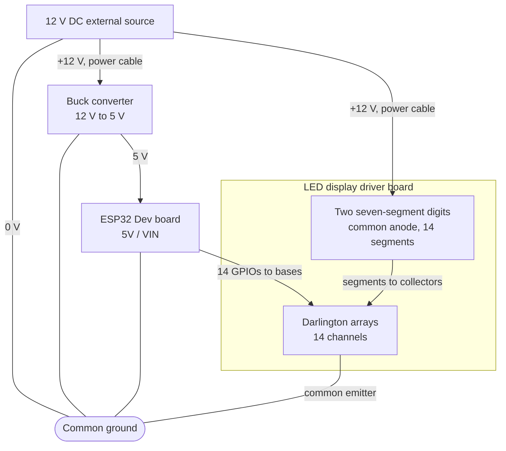

# ESP32 Seven-Segment Display Controller

Firmware for a two-digit, seven-segment display driven by an ESP32 DevKit (ESP32-WROOM-32).
Control it from any browser over Wi-Fi at **http://espTraffic.local**: set segments or numbers,
run display patterns, show an event countdown, and update the firmware over the air.

> **Status of testing.** The source has been syntax-checked against API stubs and its logic
> (GPIO mask maths, number glyphs, pattern timing, request interruption/timeout, JSON parser,
> countdown rounding) was unit-tested on a PC. It has **not** been compiled with the real
> PlatformIO toolchain or run on real hardware by the author. Test it on your board before relying on it.


## 1. Required hardware

- ESP32 DevKit with an **ESP32-WROOM-32** module (4 MB flash). **WROVER boards are not supported
  with this pin map** (GPIO16/17 are used for PSRAM there).
- Two seven-segment digits, common-anode, one dedicated GPIO per segment (14 GPIOs, no multiplexing),
  switched through Darlington transistor arrays. **GPIO HIGH = segment ON.**
- 2.4 GHz Wi-Fi network with DHCP.

## 2. GPIO mapping

Defined once in `config.h` (`DIGIT_PINS[digit][segment]`); nothing else in the code names a pin.

| Segment | Left digit (tens) | Right digit (units) |
|---|---|---|
| A | GPIO26 | GPIO19 |
| B | GPIO4  | GPIO13 |
| C | GPIO17 | GPIO22 |
| D | GPIO33 | GPIO27 |
| E | GPIO16 | GPIO23 |
| F | GPIO25 | GPIO32 |
| G | GPIO18 | GPIO21 |

## 3. Hardware layout



### One channel (repeated 14 times)

```text
+12 V ───► LED segment ───► C ┐
                              │  Darlington
ESP32 GPIO ───────────────► B ┤  channel
                              │
GND ◄─────────────────────  E ┘
```

GPIO HIGH turns the channel and its segment on. GPIO LOW turns it off.

### GPIO to Darlington base

| Segment | Left digit (tens) | Right digit (units) |
|:---:|:---:|:---:|
| A | GPIO26 | GPIO19 |
| B | GPIO4 | GPIO13 |
| C | GPIO17 | GPIO22 |
| D | GPIO33 | GPIO27 |
| E | GPIO16 | GPIO23 |
| F | GPIO25 | GPIO32 |
| G | GPIO18 | GPIO21 |

## 4. Required software

- [PlatformIO](https://platformio.org/) (VS Code extension or CLI). No libraries to install:
  WiFi, WebServer, ESPmDNS, Preferences and Update ship with the ESP32 Arduino core.
- Pinned platform: `espressif32@6.5.0` (Arduino core 2.0.14). PlatformIO downloads it automatically.

**Arduino IDE:** the code is plain Arduino C++11. Put `EspTraffic_Firmware.ino`, all the `.h` files and
`partitions.csv` in a folder named `EspTraffic_Firmware`, install ESP32 core 2.0.14, choose *ESP32 Dev Module*
and Tools → Partition Scheme → *Minimal SPIFFS (1.9MB APP with OTA/190KB SPIFFS)*. The `partitions.csv` in the
sketch folder replaces that scheme's table. PlatformIO is recommended.

## 5. Open, configure, build and flash

1. Open the project folder (the one containing `platformio.ini`) in VS Code with PlatformIO
   (*File → Open Folder*), or `cd` into it in a terminal.
2. Edit the top of `config.h`:
   ```cpp
   #define WIFI_SSID "YOUR_WIFI_NAME"
   #define WIFI_PASSWORD "YOUR_WIFI_PASSWORD"
   ```
   These apply while no credentials are saved in NVS. Credentials saved through the web page take priority,
   including after later uploads.
3. **Compile:** PlatformIO toolbar → *Build*, or `pio run -e esp32dev`.
4. **Upload over USB (wired):** connect the board, then run
   ```bash
   pio run -e esp32dev -t upload --upload-port /dev/ttyUSB0
   ```
   This builds if needed and flashes at 921600 baud. `/dev/ttyUSB0` is a Linux port name; if your board
   appears under another one (`pio device list`), use that. If the upload does not start, hold the **BOOT**
   button while it says "Connecting...".

The first installation must be done over USB. Later updates can use USB or [OTA](#10-ota-firmware-update).
The firmware prints nothing on the serial port, so use the web page or `/api/info` for diagnostics.

### Startup sequence

1. All 14 outputs LOW immediately, then **every segment ON for 500 ms**, then OFF.
2. A 3 s pause with the display off.
3. Wi-Fi connects without blocking; the **figure-eight loading animation** runs until connected
   (after a 15 s attempt it waits 3 s and tries again).
4. On connection: **one 500 ms flash**, while mDNS, NTP and the web server start.
5. If Wi-Fi drops the animation returns, the device reconnects by itself, flashes once and carries on.

## 6. Using the web interface

Open **http://espTraffic.local** (or the IP address shown in your router/`/api/info`).

- Click any segment in the picture to toggle it. The picture shows the **real GPIO state** read back from the pins.
- *All OFF / All ON*, a number box (0-99), the four patterns and *Stop*.
- *Pattern configuration* sets the speed, timeout, blink count and blink targets for the pattern you start.
- Every temporary command expires after the configured **request timeout** (default 10 s), then the display
  returns to the countdown (if enabled) or turns off. A newer command always replaces the running one immediately.
- The page polls `/api/state` every 3 s; polling never changes the display or resets a timeout.
- Open the browser console (F12) for a table of controller diagnostics.

### espTraffic.local troubleshooting

mDNS works out of the box on macOS, iOS, Linux (avahi) and current Windows 10/11. On older Windows install
Apple Bonjour, or use the IP address. Some routers block multicast between Wi-Fi and wired clients.
Android browsers often cannot resolve `.local`; use the IP address.

## 7. Patterns

| Pattern | Behaviour |
|---|---|
| `flash` | all 14 segments ON/OFF together |
| `count` | 00, 11, 22 ... 99, 00 ... (both digits equal) |
| `figure8` | a 3-segment trail snakes around both digits, crossing over the two middle (G) segments. It uses the outer segments and both G bars; the four inner verticals (Left B/C, Right E/F) are not part of the path |
| `blink` | blinks chosen segments (`left.A`, `right.G`, `left`, `right`, `all`); `count` = complete ON/OFF cycles; none chosen = all; default 3 cycles, maximum 100. Ends by itself after the last cycle |

Speeds (30-5000 ms per step) are set in *Settings* or per request (`speed`); *Pattern speed* is the one `blink`
uses. Blink with no explicit timeout
extends its own timeout so the requested number of blinks completes.

## 8. Changing Wi-Fi credentials

*Settings → Wi-Fi SSID / password → Save settings*. The controller **tests the new network first**:

- success → the credentials are saved to NVS and used from now on;
- failure (20 s) → it **reverts to the previous network** and reports the failure.

The result appears under the Settings card and in `/api/state` (`wifiChange`). If the new network is a different
one, your browser will lose the connection; reconnect your computer to the new network and open
`http://espTraffic.local`. Leave the password empty to keep the stored one (same SSID), or to join an *open* network
when you change the SSID. The saved password is never returned by any API.

## 9. Countdown

*Countdown card:* pick the event date, tick **Enable countdown**, **Save**. Stored in NVS; survives reboots and OTA.

- Needs NTP time (shown as *clock synced*). Until the clock has synced nothing is shown and the API says so.
- Remaining days are rounded **up**: 2 d 3 h → 3, 1 d 4 h → 2, under 24 h → 1, event day reached → 0.
  The event date means local midnight **at the start** of that day, so the display reads `00` on the event day.
- More than 99 days shows `99`; the API/website still report the true number.
- Timezone: POSIX string in *Settings* (default Toronto `EST5EDT,M3.2.0,M11.1.0`).
- Temporary requests override the countdown; it returns when they expire. Saving countdown settings does
  not interrupt a running request.

## 10. OTA firmware update

OTA (over-the-air) updates send a compiled image over Wi-Fi to the firmware's `/update` page. The controller
must already be running this firmware and be connected to your network.

**Build the image** (this does not need the board connected):

```bash
pio run -e esp32dev
```

The image is `.pio/build/esp32dev/firmware.bin`. Then upload it in either of these ways.

**From the browser**

1. Open **http://espTraffic.local** (or `http://<device-ip>`).
2. *Firmware update* card → choose `firmware.bin` → **Upload firmware**.
3. A progress bar shows the transfer; all segments stay ON while uploading. On success the device restarts
   after ~1.5 s and the page reloads itself.

**From the command line** (run in the project folder)

```bash
curl -F "firmware=@.pio/build/esp32dev/firmware.bin" http://espTraffic.local/update
```

With authentication enabled, add `-u <username>` (curl prompts for the password). Success returns
`{"ok":true,"message":"Update successful. Restarting..."}`.

`pio run -t upload` cannot be pointed at the device's network address: this project uses the HTTP upload
above, not ArduinoOTA/`espota`.

**Notes**

- A rejected or interrupted upload (invalid image, not enough memory, lost connection) leaves the old firmware
  in place.
- Upload only `firmware.bin` (the app image), **never** `bootloader.bin` or `partitions.bin`.
- There are two 1.875 MB application slots (`partitions.csv`), so the running image is not overwritten.
  The application does no health check or rollback of its own: if a new image uploads successfully but crashes
  or cannot be reached, recover with a USB upload.
- OTA replaces the application only. Changes to `partitions.csv` need a USB upload.
- Settings, saved Wi-Fi credentials and the countdown are in NVS and **survive** the update.

## 11. Power-saving mode

Not deep sleep. Wi-Fi, mDNS and the web server stay up. When enabled: Wi-Fi modem sleep (`WIFI_PS_MIN_MODEM`,
wakes every DTIM so mDNS keeps working), the loop delay rises from 1 to 5 ms when no display request or overlay is
active, and the CPU drops from 240 to 80 MHz after 10 s of idle. Page, API and display requests wake it immediately;
an open web page polls every 3 s, so the CPU stays at 240 MHz. It is off by default and suspended during OTA.
Expect a few extra ms of latency on the first request.

## 12. Security

- HTTP only, designed for a **trusted private network**. With the default `AUTH_ENABLED 0` anyone on the network
  can control the display, change settings and flash firmware.
- Set `AUTH_ENABLED 1` plus `AUTH_USERNAME` / `AUTH_PASSWORD` in `config.h` for HTTP Basic authentication on
  the page, API, display commands, settings and OTA upload (`/favicon.ico` and the "use POST" reply to
  `GET /update` stay open). Basic auth is not encrypted: it only deters casual use.
- **Do not port-forward or otherwise expose the controller to the internet.**
- The Wi-Fi password is stored unencrypted in NVS (a requirement of connecting) and is never sent over the API.

## 13. Troubleshooting

| Symptom | Check |
|---|---|
| Figure-eight never stops | wrong SSID/password, 5 GHz-only network, weak signal. Fix `config.h` and upload over USB; if credentials were saved from the web page, erase the flash first (see factory reset) |
| `espTraffic.local` not found | use the IP (router's client list); see mDNS notes above |
| Page loads but shows *offline* | device lost Wi-Fi; wait for reconnect animation to finish |
| Countdown blank | enabled? valid date saved? "clock synced"? (NTP needs internet access) |
| Wrong number of days | check timezone string in Settings |
| A segment never lights | wiring/Darlington channel; light it alone with `curl -H "Content-Type: application/json" -d '{"mask":1}' http://espTraffic.local/api/segments` (1 = left A; double for each next segment, left A-G then right A-G) |
| OTA fails | upload `firmware.bin` (app image), keep at least 30,000 bytes of heap free, stay on the same network |
| Lost the device after a typo in Wi-Fi settings | a change made in the web page is tested first and reverted if the connection fails |
| Needs a factory reset of settings | erases the firmware too: run `pio run -e esp32dev -t erase --upload-port /dev/ttyUSB0`, then upload over USB again |

## 14. Project layout

```
EspTraffic_Firmware.ino  setup() and the non-blocking loop()
platformio.ini           board, pinned platform, partition table
partitions.csv           nvs + otadata + 2 x 1.875 MB app slots + spiffs
config.h                 GPIO map, Wi-Fi defaults, hostname, timeouts, TZ, power, auth
display.h                batched GPIO register output, glyphs, segment parsing
storage.h                validated NVS settings
countdown.h              NTP/timezone + days-remaining
power.h                  modem sleep, CPU scaling
patterns.h               request manager, timeouts, 4 patterns, loading overlay
networking.h             non-blocking Wi-Fi state machine, mDNS, credential trial
webserver.h              HTTP server, JSON API, OTA
web_ui.h                 embedded HTML/CSS/JS (PROGMEM)
```

## 15. How the GPIO update works

`setDisplayState(mask)` builds per-bank pin masks and writes the ESP32 W1TC/W1TS registers (bank 0 = GPIO0-31,
bank 1 = GPIO32-39): at most four register writes per update, touching only the 14 display pins. GPIO32/33 live
in bank 1, so two banks change a few nanoseconds apart. If the core lacks the register macros, a `digitalWrite()`
fallback is compiled automatically (`DISPLAY_USE_REGISTERS` in `display.h`).
